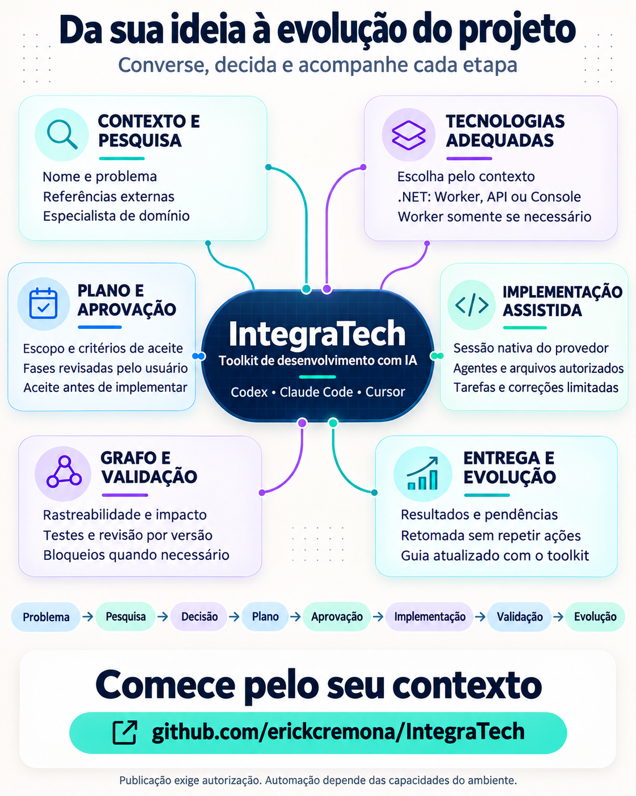

# IntegraTech — arquitetura e toolkit de desenvolvimento com IA

O IntegraTech ajuda a transformar um problema em um projeto com contexto pesquisado, tecnologias justificadas, plano aprovado, implementação, testes e revisão. Funciona com **Codex, Claude Code e Cursor**, usando o mesmo núcleo de agentes, regras e registros.

Você conversa com o agente sobre o projeto; ele organiza o trabalho e prepara os registros. Você esclarece o contexto, revisa as propostas e aprova as decisões necessárias. A base disponível é .NET 8 em camadas, com Worker, API ou Console conforme a necessidade.

## Entenda o fluxo



[Abrir o mapa em tamanho completo](docs/imagens/mapa-mental-integratech.png) · [Fluxo de uso do toolkit](docs/inicio/fluxo-toolkit.md)

**Nome e problema → contexto e pesquisa → decisão tecnológica → plano e aprovação → implementação → testes e revisão → entrega → evolução.**

| Etapa | O que você faz | O que o toolkit prepara |
|---|---|---|
| Início | Informa o nome e descreve o problema | Perguntas apenas sobre o que falta e contexto registrado |
| Pesquisa e tecnologia | Esclarece restrições e revisa alternativas | Fontes externas, especialista de domínio e recomendação técnica |
| Criação ou adoção | Aprova a base e escolhe sua cópia/destino | Identidade, estrutura e adaptadores dos provedores selecionados |
| Plano | Revisa escopo, fases e critérios; aprova o plano | Desenho consultado com o especialista e registros de aceite |
| Implementação | Solicita a fase aprovada | Tarefa, arquivos autorizados, código na sessão nativa e grafo atualizado |
| Validação e revisão | Acompanha resultados e resolve decisões pendentes | Testes, pareceres vinculados à versão do código e análise de bloqueios |
| Entrega e evolução | Revisa a entrega e informa mudanças | Resumo verificável, próximos passos, handoff e análise de impacto |

## Comece em sua própria cópia

No [repositório oficial](https://github.com/erickcremona/IntegraTech), use **Use this template → Create a new repository** ou **Code → Download ZIP**. Abra sua cópia no Codex, Claude Code ou Cursor. O repositório oficial permanece como modelo reutilizável; o GitHub não renomeia namespaces automaticamente.

Requisitos: **Node.js >=22**, **SDK .NET 8** e a ferramenta de IA escolhida com autenticação configurada. A criação não instala dependências nem configura credenciais ou Git.

Envie uma mensagem como:

> Meu projeto se chamará AgendaFacil. Quero resolver agendamentos feitos por mensagens, com horários duplicados e dificuldade para confirmar atendimentos. Entenda o contexto, pesquise as tecnologias adequadas e apresente uma proposta antes de implementar. Quero os adaptadores de Codex, Claude e Cursor.

Não precisa preparar JSON ou conhecer os comandos: o agente deve registrar os fatos informados e perguntar somente o necessário. Se o projeto já foi personalizado, ele lê o contexto existente e continua dali. Veja [adoção da cópia](docs/inicio/adotar-projeto.md) e [primeiro projeto](docs/inicio/primeiro-projeto.md).

Worker é um exemplo opcional, mantido apenas quando processamento em segundo plano fizer sentido. API e Console também estão disponíveis. Outras tecnologias podem ser recomendadas, mas uma stack sem gerador exige implementação própria; não será substituída por uma aproximação .NET. Banco, autenticação, mensageria e integrações entram apenas quando o contexto justificar.

Na criação/adoção, `all` inclui as três ferramentas; `both`, padrão existente, inclui somente Codex+Claude. Consulte [uso no Cursor](docs/inicio/cursor.md). O nome do projeto deve ser PascalCase alfanumérico, sem espaços ou nomes reservados.

## Conduza o trabalho pela conversa

| Quando precisar | Exemplo de pedido |
|---|---|
| Entender o negócio | “Organize o contexto, os usuários, as regras e as dúvidas antes de desenhar a solução.” |
| Decidir tecnologias | “Compare alternativas com fontes externas e explique a recomendação para este contexto.” |
| Planejar | “Prepare fases com escopo, critérios de aceite e validações. Aguarde minha aprovação.” |
| Implementar | “Implemente a primeira fase aprovada e apresente testes, revisão e pendências.” |
| Consultar andamento | “O que está concluído, o que falta e o que está bloqueado?” |
| Alterar o projeto | “O contexto mudou desta forma: … Analise o impacto antes de alterar o código.” |
| Retomar | “Retome pelos registros existentes e confirme o próximo passo sem repetir ações anteriores.” |

A aprovação técnica da base e a aprovação do plano de negócio são decisões distintas. Alterações no contexto/plano podem invalidar aceites e evidências anteriores. O agente principal atua como CTO e encaminha o trabalho aos especialistas; você não precisa invocar cada agente manualmente.

## Como o toolkit acompanha e valida

O **grafo de rastreabilidade** relaciona documentos e itens explícitos de contexto, requisitos, decisões, tarefas, componentes, testes, evidências e aceites. O agente de rastreabilidade sincroniza essas relações e separa propostas ambíguas para revisão. Um grafo vazio ou incompleto não comprova cobertura. [Grafo e análise de impacto](docs/inicio/grafo-rastreabilidade.md).

O **loop assistido** registra o candidato e vincula validação e revisões ao mesmo hash do código. Preserva testes originais, limita tentativas e correções e invalida evidências quando os insumos mudam. A implementação ocorre na sessão nativa; a implementação automática permanece desabilitada. [Funcionamento do loop](docs/inicio/loop-engenharia.md).

Testes isolados exigem ambiente compatível: o executor disponível usa Linux/Bubblewrap e bloqueia quando o isolamento não pode ser comprovado. O dispatcher automatiza revisões Codex/Claude com pacote explícito autorizado e provedor compatível; Cursor usa a sessão nativa e seus adaptadores, sem dispatcher automatizado. Testes locais e simulações não comprovam funcionamento dos serviços externos. [Limites e confiabilidade](docs/inicio/confiabilidade.md).

Você recebe arquivos alterados, resultados observados, limitações e próximos passos. Entrega não publica o produto: push, merge, deploy e outras operações externas exigem autorização aplicável.

## Comandos para operação direta

O agente pode executar os comandos necessários dentro da autorização recebida. Para conferir a base manualmente:

```powershell
npm test
npm run check
npm run toolkit -- doctor
npm run toolkit -- precheck --phase discovery
dotnet build IntegraTech.sln --disable-build-servers -m:1
dotnet run --project tests/IntegraTech.Arquitetura.Tests --no-build
```

Em um projeto personalizado, use o nome de sua solução e do projeto de testes. O teste .NET é um executável de ciclo de vida; `dotnet test` sozinho não o executa. `doctor` verifica capacidades das CLIs, sem comprovar autenticação ou disponibilidade de modelo. `npm run verify` executa a verificação reproduzível do toolkit e dos modelos gerados/adotados; não executa avaliações com modelos reais automaticamente.

Para gerar em outra pasta vazia, após preparar contexto completo, pesquisa externa e decisão aprovada:

```powershell
npm run toolkit -- create-project --name MeuProjeto --target C:\Projetos\MeuProjeto --context-file .scratch/contexto.json --preparation-file .scratch/pesquisa.json --technology-file .scratch/tecnologia.json --provider all --dry-run
```

Revise a simulação e repita sem `--dry-run` para criar. O projeto não herda histórico Git, remotos, credenciais, artefatos locais ou aprovações de outro projeto. Contexto/pesquisa insuficientes bloqueiam a criação. [Decisão tecnológica](docs/inicio/decisao-tecnologica.md) · [Especialista de domínio](docs/inicio/especialista-dominio.md) · [Manual de comandos](tools/IntegraTech.IA.Toolkit/README.md).

## Documentação que acompanha a evolução

Este README é a entrada para o usuário. **Toda mudança no funcionamento ou fluxo do toolkit deve atualizar esta orientação e os guias afetados na mesma entrega**, incluindo exemplos, limitações, provedores e mapa mental quando houver mudança material. O README dos projetos gerados aponta para o guia de fluxo que acompanha cada cópia.

Quem mantém o toolkit deve revisar o baseline dos arquivos controlados após atualizar a documentação, validar adaptadores, geração/adoção e executar os checks aplicáveis. Projetos existentes não são atualizados silenciosamente: preserve customizações e atualize sua documentação junto com o toolkit instalado.

[Guia completo de uso](docs/inicio/fluxo-toolkit.md) · [Operação do toolkit](tools/IntegraTech.IA.Toolkit/README.md) · [Arquitetura](docs/arquitetura/base.md) · [Retomada](references/README.md).

Documentos em `docs/superpowers` e `docs/validacao` registram a manutenção do modelo e são excluídos da geração. Avisos legais são preservados em `THIRD-PARTY-NOTICES.md`.
