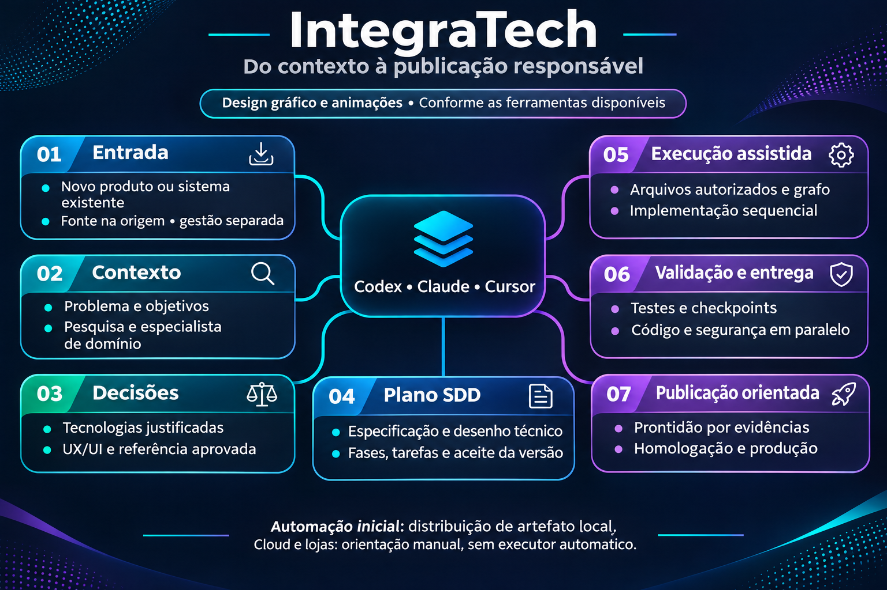
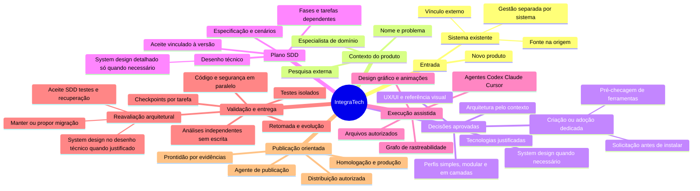

# IntegraTech — arquitetura e toolkit de desenvolvimento com IA

O IntegraTech ajuda a transformar um problema em um projeto com contexto pesquisado, tecnologias justificadas, plano aprovado, implementação, testes e revisão. Funciona com **Codex, Claude Code e Cursor**, usando o mesmo núcleo de agentes, regras e registros.

Você conversa com o agente sobre o projeto; ele organiza o trabalho e prepara os registros. Você esclarece o contexto, revisa as propostas e aprova as decisões necessárias. A tecnologia do produto é escolhida pelo contexto, pela pesquisa e pela decisão aprovada; o toolkit não instala nem gera uma stack de produto padrão.

## Entenda o fluxo



[Abrir mapa em resolução original](docs/imagens/mapa-mental-integratech-v2.png)


<details>
<summary>Versão textual e editável do mapa</summary>



</details>

[Fluxo de uso do toolkit](docs/inicio/fluxo-toolkit.md) · [Execução SDD](docs/inicio/sdd.md)

**Contexto e pesquisa → decisões → system design quando justificado → especificação e desenho → plano faseado aprovado → tarefas → testes e revisão → checkpoints → entrega e evolução.**

| Etapa | O que você faz | O que o toolkit prepara |
|---|---|---|
| Início | Informa se é novo produto ou sistema existente, nome e problema | Contexto registrado; para legado, solicita o caminho e prepara vínculo separado |
| Pesquisa e tecnologia | Esclarece restrições e revisa alternativas | Fontes externas, especialista de domínio e recomendação técnica |
| Criação ou adoção | Aprova a base e escolhe sua cópia/destino | Identidade, estrutura e adaptadores dos provedores selecionados |
| Plano SDD | Revisa requisitos, cenários, desenho, fases e tarefas; aprova o plano | Decomposição com dependências, testes e aceite vinculado à versão |
| Implementação | Solicita a fase aprovada | Tarefa, arquivos autorizados, skill Ponytail para engenharia enxuta, código na sessão nativa e grafo atualizado |
| Validação e revisão | Acompanha resultados e resolve decisões pendentes | Testes, pareceres vinculados à versão do código e análise de bloqueios |
| Entrega e evolução | Revisa a entrega e informa mudanças | Resumo verificável, próximos passos, handoff e análise de impacto |

## Sistemas existentes

O toolkit também pode manter um sistema já existente, preservando seu código na pasta original. Informe que deseja trabalhar em um legado e forneça o local quando solicitado. Cada sistema terá contexto, planos SDD, grafo e evidências em uma área de gestão separada dentro da instalação do toolkit. O vínculo não modifica o sistema; as alterações de manutenção são implementadas na origem após os gates aplicáveis. Sinais de interface sem perfil aprovado bloqueiam o candidato de manutenção; finalizar a coerência preserva a entrega quando apenas os metadados de encerramento mudam.

Uma instalação pode manter vários vínculos, selecionados explicitamente por --project ID. A análise parte da arquitetura e stack existentes; reconhecer uma tecnologia não garante que haja executor de validação compatível. [Fluxo de vínculo e manutenção](docs/inicio/sistemas-existentes.md).

## Comece em sua própria cópia

No [repositório oficial](https://github.com/erickcremona/IntegraTech), use **Use this template → Create a new repository** ou **Code → Download ZIP**. Abra sua cópia no Codex, Claude Code ou Cursor. O repositório oficial permanece como modelo reutilizável; o GitHub não renomeia namespaces automaticamente.

Requisitos centrais do toolkit: **Node.js >=22**, npm e `curl` para pesquisa HTTPS; Git também é verificado quando a cópia tem `.git`. Use `npm run toolkit -- dependencies --provider <codex|claude|cursor|both|all>` para consultar o ambiente. O diagnóstico mostra fontes oficiais e comandos sugeridos sem instalar automaticamente. CLIs Codex/Claude são necessárias ao dispatcher de revisão independente; sua ausência limita essa capacidade, mas não a sessão nativa do provedor. Uma inspeção inconclusiva de requisito central bloqueia a adoção até nova verificação. Autenticação não é verificada automaticamente; Cursor usa a sessão nativa. Runtimes e SDKs de produto dependem da tecnologia aprovada e são definidos no plano do produto. Plugins externos/MCPs só são necessários quando o plano aprovado os exigir.

No primeiro uso, a fábrica verifica se o runtime, `curl` e os agentes/skills do provedor selecionado estão disponíveis (`npm run toolkit -- doctor --quick`). Se um adaptador estiver ausente, mostra como restaurá-lo sem sobrescrever personalizações; o CTO pode usar a skill canônica e seguir com discovery e tarefas independentes enquanto isso. Instalações e autenticação de ferramentas globais continuam sob controle do usuário.

Envie uma mensagem como:

> Meu projeto se chamará AgendaFacil. Quero resolver agendamentos feitos por mensagens, com horários duplicados e dificuldade para confirmar atendimentos. Entenda o contexto, pesquise as tecnologias adequadas e apresente uma proposta antes de implementar. Quero os adaptadores de Codex, Claude e Cursor.

Não precisa preparar JSON ou conhecer os comandos: o agente deve registrar os fatos informados e perguntar somente o necessário. Se o projeto já foi personalizado, ele lê o contexto existente e continua dali. Veja [adoção da cópia](docs/inicio/adotar-projeto.md) e [primeiro projeto](docs/inicio/primeiro-projeto.md).

A criação e a adoção registram a tecnologia e a arquitetura aprovadas, sem gerar código de produto. Após aprovar o plano, a implementação segue essa decisão e as capacidades disponíveis no ambiente. Para produtos com interface ou jornadas, a adoção pode recomendar avaliar Product Design como plugin opcional; confirme disponibilidade na superfície selecionada, sem inferir suporte de CLI ou entre provedores. Recomendações não instalam nem conectam componentes. .NET pode ser recomendado quando a pesquisa e o contexto justificarem, como qualquer outra alternativa; não há projeto .NET de exemplo no modelo. Banco, autenticação, mensageria e integrações entram apenas quando o contexto justificar.

Depois que a cópia for adotada como projeto real (`is_model=false`), avalie se o contexto justifica Playwright, Supabase, Strix, SkillUI ou Context7. Esses itens não são instalados por padrão; use apenas os necessários ao escopo aprovado. Consulte [o fluxo de adoção](docs/inicio/adotar-projeto.md).

Na criação/adoção, `all` inclui as três ferramentas; `both`, padrão existente, inclui somente Codex+Claude. Consulte [uso no Cursor](docs/inicio/cursor.md). O nome do projeto deve ser PascalCase alfanumérico, sem espaços ou nomes reservados.

Após a criação ou adoção, os documentos de entrada passam a apresentar seu produto: problema, público, resultados, decisões e próximo passo. Os agentes continuam o projeto existente; os manuais de criação do toolkit ficam como referência secundária. Os resumos devem acompanhar a evolução e o estado atual é conferido em references/project-state.json.

## Conduza o trabalho pela conversa

| Quando precisar | Exemplo de pedido |
|---|---|
| Entender o negócio | “Organize o contexto, os usuários, as regras e as dúvidas antes de desenhar a solução.” |
| Decidir tecnologias | “Compare alternativas com fontes externas e explique a recomendação para este contexto.” |
| Planejar | “Prepare fases com escopo, critérios de aceite e validações. Aguarde minha aprovação.” |
| Implementar | “Implemente a primeira fase aprovada e apresente testes, revisão e pendências.” |
| Consultar andamento | “O que está concluído, o que falta e o que está bloqueado?” |
| Alterar o projeto | “O contexto mudou desta forma: … Analise o impacto antes de alterar o código.” |
| Retomar | “Retome pelos registros existentes e confirme o próximo passo sem repetir ações anteriores.” |

A aprovação técnica da base e a aprovação do plano de negócio são decisões distintas. Alterações no contexto/plano podem invalidar aceites e evidências anteriores. O agente principal atua como CTO e encaminha o trabalho aos especialistas; você não precisa invocar cada agente manualmente.

Durante implementação e refatoração, a fábrica também carrega a skill **Ponytail**: busca a menor solução completa e segura, reutiliza padrões existentes e evita abstrações sem benefício. Ela não reduz requisitos aceitos, testes, segurança, acessibilidade ou gates. A integração é adaptada ao IntegraTech e não instala hooks ou plugins globais. [Proveniência e licença](THIRD-PARTY-NOTICES.md).

## Interfaces modernas conforme o contexto

O toolkit sugere uma proposta visual moderna e pode apresentar novas opções até o usuário gostar de uma. O usuário também pode fornecer sua própria referência de interface/design. Após aprovação explícita, a referência escolhida torna-se o padrão do produto e deve orientar telas e componentes; sua substituição exige novo aceite.

Quando o projeto precisa de interface, o toolkit registra sua tecnologia separadamente do backend e prepara **ui-engineer**, uma skill especializada e os adaptadores dos provedores selecionados. O desenho parte do público, tarefas e jornadas: pesquisa referências reais com fontes/datas, propõe uma direção visual contextual e define hierarquia, tipografia, grid, tokens, conteúdo, estados e uso mobile. A meta é qualidade competitiva para o produto; um scaffold ou uma estética da moda não comprovam esse resultado.

O agente registra o desenho em `references/interface-design.json` com `ui-design-init`, prototipa na tecnologia escolhida, inspeciona o resultado renderizado em browser/ferramenta nativa e refina a composição e a interação a partir de crítica visual e observações de uso. O aceite humano efetivo do desenho e `ui-design-check` são exigidos antes do candidato de UI, vinculados ao contexto, decisão e perfil atuais. O comando inicia/valida registros; não cria pesquisa, protótipo ou aprovação automaticamente.

Há perfis de orientação para React/Vite, Next, Vue, Angular, Blazor e MAUI. O primeiro gerador testado é uma referência técnica neutra React/Vite, que exige desenho e refinamento próprios; outros perfis não são substituídos por ele. O fluxo de desenho não fornece novos renderizadores. A preparação acontece após a decisão técnica aprovada; gerar frontend exige também plano/aceite de negócio. Sem UI no contexto, o projeto continua sem frontend.

A referência React passou por build e browser com teclado e axe. A revisão independente de UX/acessibilidade exige evidência visual efetivamente inspecionada e sete critérios com notas de 1 a 5, todos >=4: clareza da tarefa, hierarquia, identidade, estados, responsividade, acessibilidade e desempenho. Notas não certificam liderança de mercado ou WCAG; o dispatcher somente textual bloqueia julgamento visual sem acesso suficiente. Diagnóstico local não comprova entrega isolada: a entrega de UI permanece bloqueada enquanto o executor isolado específico estiver indisponível. [Capacidades, fluxo e comandos de interface](docs/inicio/interfaces.md).

## Plano aprovado e execução SDD

Novos produtos usam especificação funcional, desenho técnico e plano v2 faseado, com requisitos/cenários ligados às tarefas e testes previstos. Após o aceite, a fábrica materializa o plano de ação sem alterar a decomposição aprovada. Dependências exigem checkpoints de conclusão observada antes do avanço. Planos antigos são identificados como legados e precisam de migração explícita. [Fluxo e comandos SDD](docs/inicio/sdd.md).

## Recomendações e paralelismo

As orientações devem ser fundamentadas no contexto e nas evidências, explicando alternativas, custos e limites. A fábrica deve discordar quando necessário e recomendar simplificar ou não implementar quando o benefício não justificar a complexidade; concordância automática não é critério de qualidade.

Análises e pesquisas independentes podem ser delegadas em paralelo pela sessão nativa, até duas por produto e sem escrita. No loop, revisões de código e segurança ocorrem em paralelo sobre o mesmo candidato imutável; ambos os resultados são exigidos. UX permanece depois dessas revisões. A implementação de código continua sequencial por produto. Isso reduz dependências desnecessárias, mas ganho de tempo/custo precisa ser medido no uso real.

## Como o toolkit acompanha e valida

O **grafo de rastreabilidade** relaciona documentos e itens explícitos de contexto, requisitos, decisões, tarefas, componentes, testes, evidências e aceites. O agente de rastreabilidade sincroniza essas relações e separa propostas ambíguas para revisão. Um grafo vazio ou incompleto não comprova cobertura. [Grafo e análise de impacto](docs/inicio/grafo-rastreabilidade.md).

O **loop assistido** registra o candidato e vincula validação e revisões ao mesmo hash do código. Preserva testes originais, limita tentativas e correções e invalida evidências quando os insumos mudam. A implementação ocorre na sessão nativa; a implementação automática permanece desabilitada. [Funcionamento do loop](docs/inicio/loop-engenharia.md).

Validações usam os perfis fixos no sistema operacional da sessão, com ambiente reduzido, cópia temporária e limites de tempo/saída. Executam com as permissões do usuário local e são registradas como `host_controlled`, com isolamento `unverified`. O dispatcher automatiza revisões Codex/Claude com pacote explícito autorizado e provedor compatível; Cursor usa a sessão nativa e seus adaptadores, sem dispatcher automatizado. Testes locais e simulações não comprovam funcionamento dos serviços externos. [Limites e confiabilidade](docs/inicio/confiabilidade.md).

Você recebe arquivos alterados, resultados observados, limitações e próximos passos. Entrega não publica o produto: push, merge, deploy e outras operações externas exigem autorização aplicável.

## Design gráfico e animações

O toolkit inclui graphic-designer e a skill integratech-design-grafico para imagens, ilustrações, infográficos, mapas mentais e motion. A geração parte de um contrato visual curto; cada requisito obrigatório passa por revisão passa/falha. Falhas pedem edição direcionada ou nova geração antes da entrega, preservando os elementos aprovados quando a ferramenta permitir. Animações exigem cenas/quadros-chave, linha do tempo, fallback estático e atenção a reduced motion. As ferramentas disponíveis determinam os formatos reais de entrega; gerar uma imagem não significa gerar vídeo. [Fluxo e capacidades de design gráfico](docs/inicio/design-grafico.md).

Pedidos visuais são reconhecidos pela linguagem da conversa: “crie uma imagem”, “melhore o mapa mental” ou “anime este fluxo” acionam a skill de design gráfico e a coordenação de graphic-designer, sem o usuário precisar conhecer nomes técnicos. Revisões curtas usam o material anterior quando ele está definido; ambiguidades reais exigem esclarecimento. A triagem auxiliar route --request TEXT [--last-asset image|animation|diagram] usa regras limitadas; o CTO interpreta o contexto e não confunde criação de arte com implementação de upload/armazenamento de imagens. A chamada ao responsável ocorre na sessão nativa, conforme capacidades/permissões, sem automatizar publicação ou fingir geração.

## Publicação e prontidão

Após criar a solução, release-engineer orienta a distribuição conforme a stack, o público, os ambientes, custos e operação. O agente deve pesquisar alternativas e preparar um plano progressivo, sem escolher nuvem ou loja por padrão. release-init/check avaliam a versão por critérios obrigatórios e evidências, separando homologação de produção; uma pontuação não compensa bloqueios.

A automação inicial distribui um artefato local para destino explicitamente aprovado, sem sobrescrita. Ela não ativa serviços nem comprova aplicação online. Cloud e lojas continuam com orientação contextual, sem executor automático. Registros humanos de operação não são certificação; a prontidão depende da suficiência das evidências e dos gates técnicos. [Fluxo, métrica e comandos de publicação](docs/inicio/publicacao.md).

## Comandos para operação direta

O agente pode executar os comandos necessários dentro da autorização recebida. Para conferir a base manualmente:

```powershell
npm test
npm run check
npm run toolkit -- doctor
npm run toolkit -- precheck --phase discovery
```

Esses comandos verificam o toolkit. As validações de produto devem ser definidas no plano aprovado e usar ferramentas disponíveis para a tecnologia selecionada. `doctor` verifica capacidades das CLIs, sem comprovar autenticação ou disponibilidade de modelo. `npm run verify` verifica o toolkit, sem exigir o runtime do produto nem executar avaliações com modelos reais automaticamente.

`npm run toolkit -- help` mostra rotas, ações de política e contratos diretamente das definições do toolkit. `npm run check` valida os adaptadores instalados, os papéis do catálogo e todos os esquemas de contrato suportados.

Para gerar em outra pasta vazia, após preparar contexto completo, pesquisa externa e decisão aprovada:

```powershell
npm run toolkit -- create-project --name MeuProjeto --target C:\Projetos\MeuProjeto --context-file .scratch/contexto.json --preparation-file .scratch/pesquisa.json --technology-file .scratch/tecnologia.json --architecture-file .scratch/arquitetura.json --provider all --dry-run
```

Revise a simulação e repita sem `--dry-run` para criar. O projeto não herda histórico Git, remotos, credenciais, artefatos locais ou aprovações de outro projeto. Contexto/pesquisa insuficientes bloqueiam a criação. [Decisão tecnológica](docs/inicio/decisao-tecnologica.md) · [Especialista de domínio](docs/inicio/especialista-dominio.md) · [Manual de comandos](tools/IntegraTech.IA.Toolkit/README.md).

## Documentação que acompanha a evolução

Este README é a entrada para o usuário. **Toda mudança no funcionamento ou fluxo do toolkit deve atualizar esta orientação e os guias afetados na mesma entrega**, incluindo exemplos, limitações, provedores e mapa mental quando houver mudança material. O README dos projetos gerados aponta para o guia de fluxo que acompanha cada cópia.

Quem mantém o toolkit deve revisar o baseline dos arquivos controlados após atualizar a documentação, validar adaptadores, geração/adoção e executar os checks aplicáveis. Projetos existentes não são atualizados silenciosamente: preserve customizações e atualize sua documentação junto com o toolkit instalado.

[Guia completo de uso](docs/inicio/fluxo-toolkit.md) · [Operação do toolkit](tools/IntegraTech.IA.Toolkit/README.md) · [Arquitetura](docs/arquitetura/base.md) · [Retomada](references/README.md).

Documentos em `docs/superpowers` e `docs/validacao` registram a manutenção do modelo e são excluídos da geração. Avisos legais são preservados em `THIRD-PARTY-NOTICES.md`.


## Autoria

Criado por **[Erick Cremona](https://www.linkedin.com/in/erick-cremona-6983a1383/)**. [Registro de autoria da ferramenta](AUTHORS.md).


Consulte [arquitetura contextual](docs/inicio/arquitetura-contextual.md) para escolher o menor perfil adequado, registrar decisão/aceite e reavaliar evolução. Criação/adoção exigem `--architecture-file PATH`; planos SDD de produtos com arquitetura gerenciada exigem `architecture_sha256` e classificação N0–N4 por tarefa. N2+ chama revisão arquitetural independente; persistência inclui revisão de dados. Fitness functions e ferramentas são selecionadas conforme a stack aprovada, com critérios e evidências vinculados ao plano. Migrações dependem de aprovação, fases, compatibilidade, recuperação e entrega validada antes de distribuição.


O desenho de sistema é condicional aos riscos e atributos dos requisitos. Consulte [quando e como usar system design](docs/inicio/system-design.md); se exigido ou recomendado, o registro fica vinculado ao desenho técnico e ao aceite SDD.
