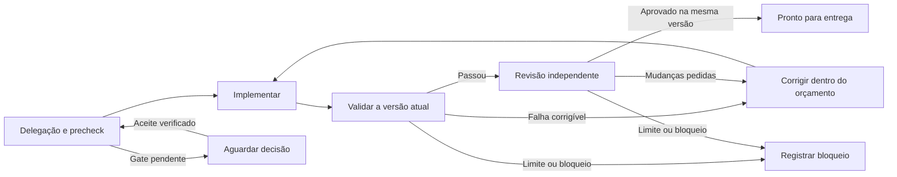

# Plano de implementação do loop de engenharia da fábrica

> **Para execução:** usar `superpowers:executing-plans` ou `superpowers:subagent-driven-development` após o aceite do desenho. Marcar cada etapa mediante evidência.

**Objetivo.** Fazer a fábrica conduzir uma tarefa autorizada da implementação à revisão final, corrigir falhas dentro de limites explícitos e retomar com segurança em outra sessão.

## Registro da execução — 2026-11-09

O incremento implementado cobre a classificação sanitizada de falhas do verificador, a restrição da ação `implement_toolkit`, o contrato e registro durável inicial da tarefa, gate recheck, snapshot/concorrência/idempotência, rotas de análise de integração, geração/adoção do novo runtime, adaptadores de Codex/Claude/Cursor e documentação. Evidências registradas na base atualizada: `npm test` 90/90; `npm run verify` passou nos 24 critérios; 8 evals locais passaram. A sessão Codex nativa está disponível nesta execução; `toolkit doctor` não detecta o executável CLI externo. Claude CLI não foi detectado; Cursor oferece somente sessão nativa, sem automação de revisão. Relatório e limitações: `docs/validacao/loop-fabrica-2026-11-09.md`.

Este registro não declara concluído o plano aprovado. O contrato não aceita estados `validation_pending`, `review_pending` ou `ready_for_delivery`. O estado local não tem proteção contra adulteração por processo com escrita no workspace. Não foi demonstrado isolamento efetivo, autenticação do Codex, execução de candidato em cópia descartável, vínculo de teste/parecer ao mesmo digest, orçamento de correção nem ganho de eficiência. O executor permanece desabilitado. A expansão exige canários e evidência por provedor/sistema operacional; ausência desses controles bloqueia habilitação automática.

**Arquitetura proposta.** O núcleo Node.js registra as transições, valida evidências e decide o próximo passo. Codex e Claude continuam adaptadores do mesmo núcleo. O primeiro incremento usa a sessão nativa para alterações. A execução automática em cópia isolada é habilitada por provedor após demonstrar isolamento e paridade.

**Escopo.** Evolução da fase `toolkit` no template canônico, com fixtures sintéticas para testar também os gates de negócio. Os comandos de adoção, aprovação de negócio e efeitos externos continuam sujeitos à governança vigente.

**Revisão do desenho em 2026-11-09.** A aprovação proposta cobre primeiro o loop assistido de uma tarefa por vez. A automação de escrita fica condicionada às evidências de isolamento e de execução real. A base mantém Node.js 22 ou superior e os contratos existentes dos provedores.

## Diagnóstico

| Área | Evidência atual | Lacuna a fechar |
|---|---|---|
| Papéis e skills | O catálogo tem oito especialistas, profundidade de delegação 1 e roteamento explícito. O validador confirma a consistência dos adaptadores. | `integration-analyst` não tem rota direta e `integratech-worker` não é referenciada pelo catálogo. O roteamento atual de integração aponta para implementação, sem distinguir a análise de contrato externo. |
| Autorização | `governance.mjs` valida fase, contexto, plano, hashes e referência de aceite. `policy.mjs` aplica regras nos utilitários que o consultam. | A referência local de aceite não comprova autoridade humana. A sessão nativa pode agir fora dos utilitários. Cada transição precisa combinar precheck com permissões efetivas da execução. |
| Execução e retomada | `dispatcher.mjs` e `runs.mjs` registram revisão, lock, duração, fingerprint e parecer. `resume` valida o JSON do handoff. | Falta estado durável da tarefa inteira e vínculo entre a versão do código, testes e parecer. Um handoff válido estruturalmente pode estar desatualizado. |
| QA e revisão | QA prevê cenários de falha. O dispatcher separa término do processo e veredito, limita o pacote e bloqueia indisponibilidade. | O parecer `changes_required` não dispara um próximo passo verificável. A fábrica não impede que uma alteração posterior invalide testes e pareceres usados na entrega. |
| Avaliações | CI versionado, suíte de utilitários, sete casos locais de onboarding e gates e protocolo opcional com modelo. | O caso local de contexto adversarial aceita continuar discovery e não comprova que um modelo ignoraria instruções maliciosas. Faltam avaliações de execução, reparo, isolamento, retomada e estado final. |
| Eficiência | Revisões têm limite de tempo e uma tentativa. O fluxo permite paralelismo com ownership independente. | Faltam medidas do ciclo completo, deduplicação de validações, orçamento agregado e detecção de repetição sem progresso. |

A verificação direta confirmou 125 arquivos no baseline e oito papéis válidos. O `verify` no sandbox falhou ao iniciar um filho Node com `EPERM`, reproduzido com `runProcess` e `node --version`. Fora do sandbox, o relatório final do `verify` retornou `passed` nos 15 itens, incluindo suíte do toolkit, sete avaliações locais, varredura de padrões e build/ciclo da solução e de Worker, API e Console gerados. A varredura pulou um binário. O diagnóstico dos provedores dentro do sandbox retornou indisponível para ambos, sob a restrição de subprocessos já observada. Autenticação e isolamento efetivo ficaram sem verificação e avaliações com modelo real não foram executadas. A evidência histórica de confiabilidade registra correções posteriores à revisão original, sem novo aceite independente daquela rodada.

### Achados da revisão

| Prioridade | Achado | Decisão incorporada |
|---|---|---|
| P0 | Um perfil de comandos permitido pode executar código candidato, inclusive scripts de build e testes. Um processo com acesso aos registros pode forjar a própria evidência. | Isolar execução candidata e verificador. Fixar perfis e critérios fora da cópia editável. O núcleo registra os resultados observados em área inacessível ao executor. |
| P0 | Em `dispatcher.mjs`, o pacote é lido antes de `beginRun`. Em `runs.mjs`, o fingerprint relê arquivos da árvore de trabalho. Uma edição entre as leituras pode associar o parecer a conteúdo diferente do enviado. | Calcular o digest a partir dos mesmos bytes que entram no pacote. Vincular parecer, cobertura, digest e candidato. |
| P0 | `runs.mjs` grava eventos e estado separadamente. O plano original não definia qual prevalece após uma interrupção entre as gravações. | Uma fonte de verdade por tarefa, revisão monotônica e reconciliação explícita de efeitos pendentes. |
| P1 | `policy.mjs` restringe `implement` à fase `business`, enquanto o piloto do plano começa em `toolkit`. O contrato de revisão também permite `approved_with_findings`, sem regra de promoção no plano original. | Definir ação técnica estreita para o piloto e uma matriz explícita de revisão por tipo, veredito e severidade. |
| P1 | Três tentativas de um cenário ajudam a detectar falhas de integração. A comparação anterior não controlava efeito de ordem, qualidade dos testes nem a contagem de tarefas bloqueadas. | Separar piloto operacional, regressões e estudo de eficiência. Avaliar com critérios congelados, cópias novas e denominadores explícitos. |

### Referências comparadas e aplicação local

| Referência primária | Decisão para o IntegraTech |
|---|---|
| [OpenAI Symphony, especificação de orquestração](https://github.com/openai/symphony/blob/main/SPEC.md) | Usar workspace por tarefa, validar seu caminho e reconciliar a execução com o estado da tarefa antes de retomar. A fábrica local tem demanda iniciada pelo CTO. Adoção de tracker e serviço contínuo dependeria de uma necessidade de concorrência entre máquinas. |
| [Anthropic, Effective harnesses for long-running agents](https://www.anthropic.com/research/effective-harnesses-for-long-running-agents) e [OpenAI, Harness engineering](https://openai.com/index/harness-engineering/) | Entregar ao executor uma tarefa verificável com próximo passo, critérios de aceite, snapshot e falhas observadas. Expor contexto versionado e converter regras recorrentes em verificações automáticas. |
| [Temporal, Retry Policies](https://docs.temporal.io/encyclopedia/retry-policies) e [SQLite, Atomic Commit](https://sqlite.org/atomiccommit.html) | Separar a decisão determinística do efeito e prever interrupção após iniciar uma etapa. Começar com registro local de escritor único e ensaios de interrupção. Se as garantias exigirem transação entre registros, avaliar SQLite antes de ampliar o armazenamento. |
| [Anthropic, Scaling Managed Agents](https://www.anthropic.com/research/managed-agents), [OWASP, Secure Coding with AI](https://cheatsheetseries.owasp.org/cheatsheets/Secure_Coding_with_AI_Cheat_Sheet.html) e [SLSA v1.2, Build Requirements](https://slsa.dev/spec/v1.2/build-requirements) | Separar núcleo, inferência e executor. Manter credenciais e estado de aprovação fora do ambiente que roda código candidato. Aplicar o princípio de proveniência gerada pelo controle ao registro local de evidência. Uma classificação SLSA exigiria avaliação própria. |
| [Agent Skills, especificação](https://agentskills.io/specification) | Validar nome, diretório e descrição das skills canônicas. Incluir gatilhos concretos e carregar material adicional só quando necessário. Validar ativação e não ativação separadamente da instalação. Permissões efetivas continuam sob o controle do runtime. |
| [Anthropic, Demystifying evals for AI agents](https://www.anthropic.com/research/demystifying-evals-for-ai-agents), [OpenAI, SWE-bench Verified](https://openai.com/index/introducing-swe-bench-verified/) e [reavaliação dos benchmarks de código](https://openai.com/index/separating-signal-from-noise-coding-evaluations/) | Avaliar o estado final com testes que reproduzem a falha e testes de regressão independentes. Manter parte dos cenários e oráculos fora do workspace editável. Inspecionar discrepâncias entre a trilha e o resultado. As pontuações de benchmarks públicos ficam fora do aceite local. |
| [METR, estudo de produtividade](https://metr.org/blog/2025-07-10-early-2025-ai-experienced-os-dev-study/) e [revisão do método](https://metr.org/blog/2026-02-24-uplift-update/) | Medir tempo humano e tempo de ponta a ponta separadamente, controlando ordem, dificuldade e seleção de tarefas. Usar os resultados externos para orientar o método. O ganho esperado da fábrica precisa de dados próprios. |
| [OpenAI, Agent Improvement Loop](https://developers.openai.com/cookbook/examples/agents_sdk/agent_improvement_loop) | Acrescentar um ciclo de melhoria da própria fábrica. Converter falhas recorrentes em regressões versionadas e comparar versões do harness antes de promover mudanças. |

## Desenho proposto

| Abordagem | Resultado e custo |
|---|---|
| Checklist nas skills | Entrega rápida. Ainda deixa transições, retomada e invalidação de evidências a cargo da conversa. |
| Máquina de estados local com adaptadores | Proposta adotada no plano. Reaproveita contratos e dispatcher, permite provar o fluxo antes de conceder execução automática e mantém o CTO responsável pela entrega. |
| Serviço externo de orquestração | Pode atender execução distribuída. Exige infraestrutura, credenciais e migração que o fluxo local ainda não demonstrou precisar. |

**Invariantes.** Cada tarefa tem um dono, uma delegação versionada e um único escritor. Toda decisão registra `task_id`, tentativa, fase, resultado e razão. Alteração no snapshot invalida testes e pareceres correspondentes. Interrupções preservam evidências e não repetem efeitos automaticamente. `ready_for_delivery` exige validação observada e todos os pareceres obrigatórios para a mesma revisão. Autorizações para merge, push, deploy, escrita em banco e outros efeitos externos ficam fora do executor.

**Limites iniciais propostos.** Até duas correções após a implementação inicial, 20 minutos de execução ativa acumulada, uma revisão por tipo obrigatório e snapshot, limite de 120 segundos por despacho conforme política vigente. Persistir o tempo consumido entre sessões, limitar cada ação ao saldo e registrar espera humana separadamente. Um resultado repetido para o mesmo candidato e a mesma falha encerra o ciclo. Repetição de erro transitório requer que a ação seja idempotente e que o orçamento comporte uma nova tentativa. Timeout ou interrupção com efeito incerto exige reconciliação antes de qualquer tentativa. Uso de tokens e custo sem dados permanecem `null`. Rever esses valores depois do piloto.

**Estado e efeitos.** O núcleo persiste uma intenção com `action_id`, fase e revisão esperada antes de chamar o executor. Ao concluir, associa o resultado observado ao mesmo `action_id`. O registro atômico por tarefa é a fonte de verdade e contém as transições necessárias à recuperação. Uma trilha de diagnóstico derivada pode ser reconstruída. Uma intenção sem confirmação retorna `reconciliation_required`. A retomada verifica o término da árvore de processos, o estado do workspace, o orçamento e a autorização atual. Um resultado duplicado ou atrasado fica associado à tentativa original, sem promover a revisão atual.

| Estado atual | Condição observada | Próximo estado |
|---|---|---|
| `awaiting_gate` | Escopo e autorização atual conferidos | `implementation_pending` |
| `implementation_pending` | Candidato capturado e ownership conferido | `validation_pending` |
| `validation_pending` | Critérios passaram sobre o candidato | `review_pending` |
| `validation_pending` ou `review_pending` | Falha corrigível ou mudanças exigidas, com saldo disponível | `implementation_pending`, com próxima tentativa e motivo |
| `review_pending` | Todos os pareceres e gates aceitos para o candidato atual | `ready_for_delivery` |
| Etapa com ação iniciada | Fim do processo ou resultado indeterminado após interrupção | `reconciliation_required` até confirmação ou bloqueio |
| Etapa ativa | Escopo violado, isolamento indisponível, repetição sem progresso ou limite atingido | `blocked`, com motivo estruturado |
| `ready_for_delivery` | Candidato, política ou evidência deixou de corresponder | Revalidar o insumo alterado antes de nova promoção |

**Evidência e confiança.** Fixar o snapshot aprovado de política e perfis de teste, o digest do candidato e os digests dos artefatos produzidos. O perfil confiável e os testes independentes ficam fora da área editável. O código candidato, incluindo build e testes, roda em ambiente isolado. O núcleo observa o resultado e registra a versão da ferramenta, perfil, saída sanitizada e critério verificado. O processo candidato não tem escrita no estado nem nos artefatos de verificação. O revisor recebe um pacote imutável e explícito. O núcleo calcula seu digest sobre os bytes enviados e verifica a cobertura do diff e dos critérios de aceite antes de aceitar o parecer.

**Dois ciclos.** O loop da tarefa corrige o candidato conforme testes e parecer. O loop de melhoria da fábrica transforma falhas recorrentes de roteamento, ferramentas ou avaliação em regressões versionadas. Mudanças na política, skills ou avaliadores passam pelo fluxo de revisão da fábrica e entram em vigor em novas tarefas ou após revalidação explícita da tarefa atual.

## Etapas e critérios de aceite

### 0. Estabelecer a linha de base

- [x] Registrar o resultado do `npm run verify` em ambiente com subprocessos permitidos.
- [x] Executar `npm run toolkit -- doctor` em ambiente com subprocessos permitidos para distinguir presença de CLI e flags. Registrar indisponibilidade, autenticação e isolamento como itens separados.
- [x] Em `verify-model.mjs`, expor o código de falha sanitizado do processo, como `EPERM`, sem saída bruta. Cobrir erro de spawn separado de saída não zero em `verify-report.test.mjs` e verificar que o CI continua usando o mesmo comando.
- [x] Em `policy.mjs` e `fabrica/policy.json`, definir a ação proposta `implement_toolkit` para o responsável técnico autorizado e o ownership aprovado. Preservar `implement` condicionado ao gate de negócio. Uma fase `toolkit` sem delegação técnica ou com escopo de produto não passa pelo piloto.

### 1. Persistir e retomar a tarefa

- [x] Criar `fabrica/team/contracts/task-run.schema.json`, `scripts/lib/task-loop.mjs` e `tests/task-loop.test.mjs`. Implementar `startTask({ repo, delegation, phase, provider })`, `inspectTask({ repo, id })` e `advanceTask({ repo, id, expectedRevision, event })`.
- [x] Adicionar no `toolkit.mjs` os comandos `loop-start --task PATH --phase PHASE --provider PROVIDER`, `loop-status --id ID` e `loop-advance --id ID --revision N --event gate_checked`. Persistir estado versionado e eventos sanitizados em `qa-artifacts/loops`. Usar lock por tarefa, revisão esperada para impedir atualização obsoleta e persistência recuperável após interrupção. Expor o próximo passo sem executar na inspeção.
- [ ] Guardar referências e hashes da delegação, política, escopo, plano/aceite quando aplicáveis, evidências e snapshot do trabalho. Incluir arquivos novos, alterados e removidos no escopo. Bloquear links, escape de diretório, conflito de escritor e retomada com insumos alterados. Testar colisão, interrupção e troca de provedor sem reaplicar passos.
- [ ] Cobrir em `task-loop.test.mjs` a interrupção antes do efeito, depois do efeito sem confirmação e depois da confirmação antes da resposta do CLI. Repetir a mesma solicitação com a mesma identidade e verificar que não há segundo efeito. Bloquear retomada se um processo anterior puder continuar escrevendo. Rodar os casos de filesystem e subprocessos em Windows e Linux.

### 2. Fechar o ciclo implementação, teste e revisão

- [ ] Usar a sessão nativa como executor inicial. Receber retorno estruturado, conferir alterações reais contra o ownership e validar por perfis de comandos versionados, com executável e argumentos separados. Executar o perfil sobre uma cópia descartável do candidato com rede e escrita restritas, mesmo no loop assistido. Exigir saída observada por critério de aceite. O contrato de delegação, o handoff e o texto produzido pelo modelo não podem fornecer shell arbitrário. Se o ambiente não suportar isolamento, registrar validação bloqueada.
- [ ] Tratar o evento recebido pelo CLI como solicitação de transição. Somente o núcleo pode registrar teste aprovado e revisão aceita após conferir execução observada, origem dos artefatos e fingerprints antes e depois da etapa. Comparar a árvore de trabalho com o snapshot inicial para detectar também alterações fora do ownership. Mudança concorrente durante teste ou revisão descarta o resultado e exige revalidação.
- [ ] Reusar `dispatcher.mjs` para revisão independente. Antes do despacho, fixar a lista de tipos obrigatórios e associar `run_id`, digest do pacote, digest do candidato e veredito ao estado da tarefa. `approved` avança se todos os gates passarem e não houver achado incompatível. `approved_with_findings` só admite promoção com resolução ou aceite registrado conforme a política. Achado `blocker` ou `high` impede promoção automática. `changes_required` gera instrução de correção no escopo. `blocked`, gate pendente e execução indisponível têm estados distintos e não resultam em entrega.
- [ ] Exercitar com fixture que falha, recebe correção e passa, seguida de parecer. Adicionar casos de pacote modificado entre coleta e despacho, teste alterado para aparentar sucesso, tentativa de forjar evidência, testes verdes com parecer negativo, parecer antigo após edição, orçamento esgotado e falha repetida. Aceite quando nenhum desses casos gera conclusão indevida.

### 3. Ajustar catálogo, skills e controles dos provedores

- [ ] Em `catalog.yaml` e `routing-scenarios.yaml`, adicionar `integration-analysis` para `integration-analyst`, mantendo a rota existente para implementação aprovada. Fazer `integratech-aplicacao` carregar `integratech-worker` apenas na apresentação Worker. Atualizar governança e skills canônicas com gatilhos de uso, entrada, saída, como reagir a falhas e limites de escrita. Cobrir análise sem escrita, implementação autorizada e projetos API ou Console que não ativam a skill Worker. Regenerar Codex e Claude pelo instalador e validar instalação e geração de projetos.
- [ ] Definir contrato interno `executeAttempt({ task, workspace, deadline, capabilities })` para piloto de execução automática. Prover cópia isolada e descartável, ambiente de subprocesso explícito, sem diretórios pessoais montados, credenciais de sistemas, plugins ou MCP desnecessários. Separar a conexão de inferência do ambiente que executa código. O sandbox do candidato fica sem rede por padrão. Confirmar com canários de leitura fora do escopo, escrita fora do workspace, execução de ferramenta proibida, saída de rede e acesso aos registros. Inspecionar o diff antes de incorporar alterações. A habilitação depende dessas provas para a combinação de provedor, versão e sistema operacional usada no piloto.
- [ ] Habilitar o piloto por provedor e por tarefa aprovada. Registrar versão, capacidades verificadas e motivo do bloqueio. Revisor continua em execução independente, somente leitura. Provedor incompatível interrompe a automação.

### 4. Demonstrar operação e medir eficiência

- [ ] Em `fabrica/evals`, acrescentar um conjunto separado para fluxo completo. Cobrir sucesso direto, correção após teste, correção após revisão, retomada em outro provedor, parecer obsoleto, entrada adversarial, gate pendente, saída inválida, timeout e ausência de progresso. Verificar o estado final do ambiente e as transições registradas.
- [ ] Integrar cenários determinísticos ao `npm run verify` sem credenciais de provedor. Executar um piloto com modelo real por provedor somente mediante autorização explícita. Usar três tentativas iniciais por cenário representativo, cada uma em cópia e sessão novas. Classificar falha de infraestrutura, regressão do loop, falha de avaliação e falha do agente. Exigir todos os casos críticos de segurança e de transição aprovados. Essas tentativas verificam viabilidade inicial.
- [ ] Para medir eficiência, parear o fluxo assistido atual e o fluxo com loop por tarefa, versão do provedor/modelo, ambiente e critérios de aceite. Alternar a ordem e recriar a cópia sem histórico da tentativa anterior. Congelar critérios e oráculos antes do estudo. Reportar quantidade de tentativas, entregas válidas, bloqueios, tempo ativo humano, tempo total, espera, retrabalho, chamadas e custo quando observado. Calcular tempo por entrega válida incluindo o tempo gasto nas tentativas mal sucedidas. Definir antes do estudo a margem mínima relevante, o número de tarefas e o tratamento de falhas de infraestrutura. Reportar incerteza da diferença pareada e omitir p90 com amostra insuficiente. Só afirmar ganho quando houver redução relevante de esforço ou duração sem queda na entrega validada ou regressão de segurança.
- [ ] Registrar eventos mínimos por tarefa, tentativa e ação, com versão do harness, perfil, duração, motivo e resultado. Usar a trilha sanitizada para reproduzir uma falha recorrente como cenário de regressão. Comparar a execução com a versão anterior antes de promover mudança de skill, prompt, política ou ferramenta. Reusar validação determinística somente com os mesmos insumos e ambiente e paralelizar apenas verificações independentes.
- [ ] Publicar relatório sanitizado por provedor em `docs/validacao`, com matriz de cenários, versões, limitações e evidências. Revisão independente examina política, persistência e limites antes de ampliar o piloto. Atualizar o baseline por meio do utilitário após revisar os arquivos controlados.

## Continuação — recuperação da criação interrompida

- [x] Corrigir o caso em que a interrupção de `loop-start` deixava um lock de criação órfão e uma pasta parcial, impedindo `loop-recover` e a retomada idempotente. A recuperação só remove a pasta parcial quando o PID do escritor está comprovadamente encerrado, não existe estado persistido e não há links no caminho. Se o estado já foi persistido, valida-o antes de remover o lock. Nenhuma ação de implementação é repetida.
- [x] Cobrir o caso com teste de regressão observado em RED e GREEN em Windows. Repetir suíte completa e verificações após a alteração.
- [x] Corrigir falso positivo Windows em `validateInstalled`: arquivos com LF/CRLF equivalentes eram reportados como deriva. Normalizar CRLF somente para comparação, cobrir em teste e verificar todos os adaptadores.
- [x] Regenerar o baseline revisado para os 170 arquivos controlados e executar `npm test` (90/90), `npm run check`, `validate --provider all` e `npm run verify` (24 critérios).
- [x] Tratar lock de criação truncado como inválido, sem removê-lo quando não é possível identificar e confirmar o encerramento do escritor. O estado parcial fica preservado e a recuperação falha fechada; teste de regressão verifica o motivo e a preservação.
- [x] Corrigir contagem histórica e sintaxe do evento no cabeçalho/checklist após revisão independente.
- [ ] Executar coherence-run/coherence-check após a revisão global. `coherence-run` foi tentado e bloqueou: falta especialista de domínio, enquanto o contexto de negócio canônico está vazio e a fase registrada permanece discovery pendente. Não preencher contexto de produto por inferência para fechar uma manutenção do toolkit.

## Saída de cada entrega

1. **Linha de base reproduzível** com falhas de ambiente distinguíveis de regressões.
2. **Loop assistido verificável** com estado durável, correções limitadas, retomada e parecer vinculado ao snapshot.
3. **Loop automático demonstrado por provedor** com isolamento observado, critérios de aceite cumpridos e métricas comparáveis.

Rollback da automação consiste em desativar o executor do provedor, confirmar o fim da execução e reconciliar efeitos pendentes. A sessão nativa continua a partir da última revisão válida do estado após revalidar candidato e autorização. Preservar histórico, snapshots e pareceres para diagnóstico.
